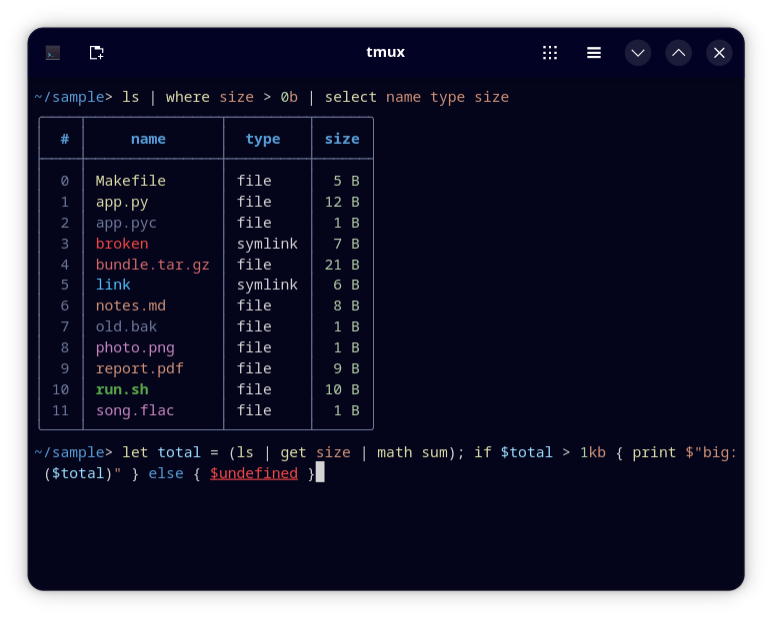

# Deepwick for Nushell

Deepwick colors for [Nushell](https://www.nushell.sh): syntax highlighting, tables and menus.

> Deepwick is an unofficial theme derived from
> [Polywick Blue](https://vscode.polywickstudio.net) by Polywick Studio (MIT).
> Not affiliated with Polywick Studio.



## Install

```sh
mkdir -p "${XDG_CONFIG_HOME:-$HOME/.config}/nushell/themes"
cp deepwick.nu "${XDG_CONFIG_HOME:-$HOME/.config}/nushell/themes/"
```

## Activate

Add to `config.nu` (`config nu` opens it):

```nu
source ($nu.default-config-dir | path join themes deepwick.nu)
```

Put any of your own `color_config` tweaks after that line.

## Notes

- Commands (built-in and external) Yellow, keywords Blue, strings Orange,
  flags and variables Light Blue, numbers Sage, signatures Teal, parse errors
  Red underlined, paths and globs underlined. Table headers are Blue bold,
  dates Comment, hints Muted.
- Nushell has no syntax shape for comments, so comments use the terminal's
  default color and are not italic.
- File names in `ls` tables are colored by `LS_COLORS`; pair this with
  [Deepwick for dircolors](https://github.com/deepwick/dircolors).
- The completion, IDE, history and help menus are restyled; menus you define
  yourself keep their style. Missing built-in menus are added with Nushell's
  default layout.

Tested with Nushell 0.113.1.

## License

MIT. See [LICENSE](LICENSE).
